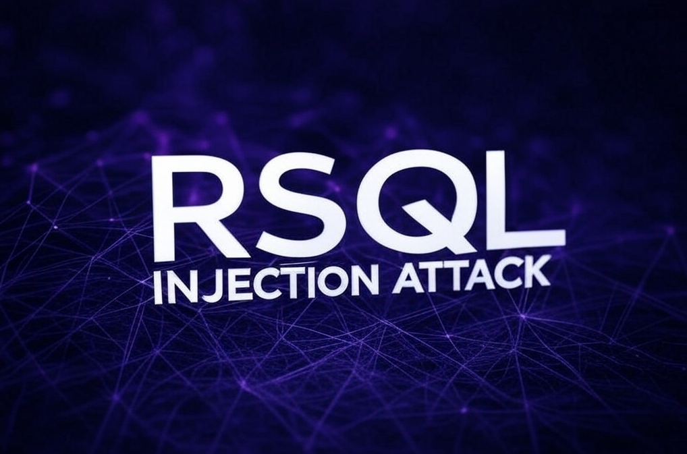

## ¿Qué es RSQL?

RSQL es un lenguaje de consulta diseñado para el filtrado parametrizado de entradas en APIs RESTful. Basado en FIQL (Feed Item Query Language), especificado originalmente por Mark Nottingham para consultar feeds Atom, RSQL destaca por su simplicidad y su capacidad para expresar consultas complejas de forma compacta y compatible con URI sobre HTTP. Esto lo convierte en una excelente elección como lenguaje de consulta general para búsquedas en endpoints REST.

## ¿Qué es la Inyección RSQL?

La Inyección RSQL es una vulnerabilidad en aplicaciones web que utilizan RSQL como lenguaje de consulta en APIs RESTful. Similar a la Inyección SQL y la Inyección LDAP, esta vulnerabilidad ocurre cuando los filtros RSQL no se sanitizan correctamente, permitiendo a un atacante inyectar consultas maliciosas para acceder, modificar o eliminar datos sin autorización.

## ¿Cómo funciona?

RSQL permite construir consultas avanzadas en APIs RESTful, por ejemplo:
```bash
/products?filter=price>100;category==electronics
```

Esto se traduce en una consulta estructurada que filtra productos con precio mayor que 100 y categoría "electronics".

Si la aplicación no valida correctamente la entrada del usuario, un atacante podría manipular el filtro para ejecutar consultas inesperadas, como:
```bash
/products?filter=id=in=(1,2,3);delete_all==true
```
O incluso aprovechar para extraer información sensible con consultas booleanas o subconsultas anidadas.

## Riesgos
- **Exposición de datos sensibles:** Un atacante puede recuperar información que no debería ser accesible.
- **Modificación o eliminación de datos:** Inyección de filtros que alteran los registros de la base de datos.
- **Escalada de privilegios:** Manipulación de identificadores que otorgan roles mediante filtros para engañar a la aplicación y acceder con privilegios de otros usuarios.
- **Evasión de controles de acceso:** Manipulación de filtros para acceder a datos restringidos.
- **Suplantación o IDOR:** Modificación de identificadores entre usuarios mediante filtros que permiten acceder a información y recursos de otros usuarios sin estar debidamente autenticado como tal.

## Detección de puntos de entrada
RSQL permite construir consultas a través de los parámetros `q` o `query`. Si estos parámetros se concatenan directamente en las consultas sin validación, son vulnerables.
#### Parámetros GET
```console
GET /api/v2/users?q=username==admin # Enumeración de usuarios o extracción de datos
GET /api/v2/users?q=username==admin;password==* # Omisión de autenticación
GET /api/v2/users?filter[username]=admin Enumeración de usuarios o extracción de datos
GET /api/v2/users?filter[username]==admin;password==* # Omisión de autenticación
GET /api/v2/users?include=roles,permissions # Enumeración de usuarios o extracción de datos
GET /api/v2/users?include=roles,(select * from users) # Ejecución de código malicioso
GET /api/v2/users?sort=id;drop table users # Ejecución de código malicioso
```

#### Parámetros POST, TRACE o PUT
```console
{
  "query": "username==admin;password==*" # Omisión de autenticación
}
```

#### Cabeceras HTTP
Algunas APIs permiten enviar consultas en las cabeceras HTTP.
```console
<HEADER>: username==admin;password==* # Omisión de autenticación
```

## Operadores RSQL admitidos

| Operador | Descripción | Ejemplo |
|--------|------------|---------|
| `;` / `and` | Operador lógico **AND**. Filtra filas donde *ambas* condiciones son *verdaderas* | `/api/v2/myTable?q=columnA==valueA;columnB==valueB` |
| `,` / `or` | Operador lógico **OR**. Filtra filas donde *al menos una* condición es *verdadera* | `/api/v2/myTable?q=columnA==valueA,columnB==valueB` |
| `==` | Realiza una consulta de **igualdad**. Devuelve todas las filas de *myTable* donde los valores en *columnA* son exactamente iguales a *queryValue* | `/api/v2/myTable?q=columnA==queryValue` |
| `=q=` | Realiza una consulta de **búsqueda**. Devuelve todas las filas de *myTable* donde los valores en *columnA* contienen *queryValue* | `/api/v2/myTable?q=columnA=q=queryValue` |
| `=like=` | Realiza una consulta **like**. Devuelve todas las filas de *myTable* donde los valores en *columnA* son similares a *queryValue* | `/api/v2/myTable?q=columnA=like=queryValue` |
| `=in=` | Realiza una consulta **in**. Devuelve todas las filas de *myTable* donde *columnA* contiene *valueA* OR *valueB* | `/api/v2/myTable?q=columnA=in=(valueA, valueB)` |
| `=out=` | Realiza una consulta de **exclusión**. Devuelve todas las filas de *myTable* donde los valores en *columnA* no son ni *valueA* ni *valueB* | `/api/v2/myTable?q=columnA=out=(valueA,valueB)` |
| `!=` | Realiza una consulta de *no igualdad*. Devuelve todas las filas de *myTable* donde los valores en *columnA* no son iguales a *queryValue* | `/api/v2/myTable?q=columnA!=queryValue` |
| `=notlike=` | Realiza una consulta **not like**. Devuelve todas las filas de *myTable* donde los valores en *columnA* no son similares a *queryValue* | `/api/v2/myTable?q=columnA=notlike=queryValue` |
| `<` & `=lt=` | Realiza una consulta de **menor que**. Devuelve todas las filas de *myTable* donde los valores en *columnA* son menores que *queryValue* | `/api/v2/myTable?q=columnA<queryValue` <br> `/api/v2/myTable?q=columnA=lt=queryValue` |
| `=le=` & `<=` | Realiza una consulta de **menor o igual que**. Devuelve todas las filas de *myTable* donde los valores en *columnA* son menores o iguales que *queryValue* | `/api/v2/myTable?q=columnA<=queryValue` <br> `/api/v2/myTable?q=columnA=le=queryValue` |
| `>` & `=gt=` | Realiza una consulta de **mayor que**. Devuelve todas las filas de *myTable* donde los valores en *columnA* son mayores que *queryValue* | `/api/v2/myTable?q=columnA>queryValue` <br> `/api/v2/myTable?q=columnA=gt=queryValue` |
| `>=` & `=ge=` | Realiza una consulta de **igual o mayor que**. Devuelve todas las filas de *myTable* donde los valores en *columnA* son iguales o mayores que *queryValue* | `/api/v2/myTable?q=columnA>=queryValue` <br> `/api/v2/myTable?q=columnA=ge=queryValue` |
| `=rng=` | Realiza una consulta de **rango (desde-hasta)**. Devuelve todas las filas de *myTable* donde los valores en *columnA* son iguales o mayores que *fromValue*, y menores o iguales que *toValue* | `/api/v2/myTable?q=columnA=rng=(fromValue,toValue)` |

**Nota**: Tabla basada en información de las aplicaciones [**MOLGENIS**](https://molgenis.gitbooks.io/molgenis/content/) y [**rsql-parser**](https://github.com/jirutka/rsql-parser).

#### Ejemplos
- name=="Kill Bill";year=gt=2003
- name=="Kill Bill" and year>2003
- genres=in=(sci-fi,action);(director=='Christopher Nolan',actor==*Bale);year=ge=2000
- genres=in=(sci-fi,action) and (director=='Christopher Nolan' or actor==*Bale) and year>=2000
- director.lastName==Nolan;year=ge=2000;year=lt=2010
- director.lastName==Nolan and year>=2000 and year<2010
- genres=in=(sci-fi,action);genres=out=(romance,animated,horror),director==Que*Tarantino
- genres=in=(sci-fi,action) and genres=out=(romance,animated,horror) or director==Que*Tarantino

**Nota**: Tabla basada en información de la aplicación [**rsql-parser**](https://github.com/jirutka/rsql-parser).

## Filtros comunes
Estos filtros ayudan a refinar las consultas en las APIs:

| Filtro | Descripción | Ejemplo |
|--------|------------|---------|
| `filter[users]` | Filtra resultados por usuarios específicos | `/api/v2/myTable?filter[users]=123` |
| `filter[status]` | Filtra por estado (activo/inactivo, completado, etc.) | `/api/v2/orders?filter[status]=active` |
| `filter[date]` | Filtra resultados dentro de un rango de fechas | `/api/v2/logs?filter[date]=gte:2024-01-01` |
| `filter[category]` | Filtra por categoría o tipo de recurso | `/api/v2/products?filter[category]=electronics` |
| `filter[id]` | Filtra por un identificador único | `/api/v2/posts?filter[id]=42` |


## Parámetros comunes
Estos parámetros ayudan a optimizar las respuestas de la API:

| Parámetro | Descripción | Ejemplo |
|-----------|------------|---------|
| `include` | Incluye recursos relacionados en la respuesta | `/api/v2/orders?include=customer,items` |
| `sort` | Ordena los resultados en orden ascendente o descendente | `/api/v2/users?sort=-created_at` |
| `page[size]` | Controla el número de resultados por página | `/api/v2/products?page[size]=10` |
| `page[number]` | Especifica el número de página | `/api/v2/products?page[number]=2` |
| `fields[resource]` | Define qué campos devolver en la respuesta | `/api/v2/users?fields[users]=id,name,email` |
| `search` | Realiza una búsqueda más flexible | `/api/v2/posts?search=technology` |

## Omisión de autenticación
Si no existe una validación correcta, sería posible evadirla utilizando el valor comodín `*` como contraseña o intentar adivinarla mediante una secuencia y asterisco:

#### Parámetros GET
```console
GET /api/v2/users?q=username==admin;password==* 
```

#### Parámetros POST, TRACE o PUT
```console
{
  "query": "username==admin;password==*"
}
```

#### Cabeceras HTTP
Algunas APIs permiten enviar consultas en las cabeceras HTTP.
```console
<HEADER>: username==admin;password==*
```

## Fuga de información y enumeración de usuarios
La siguiente ilustración muestra un endpoint de registro que requiere el parámetro email para comprobar si hay algún usuario registrado con ese email y devuelve true o false dependiendo de si existe o no en la base de datos:
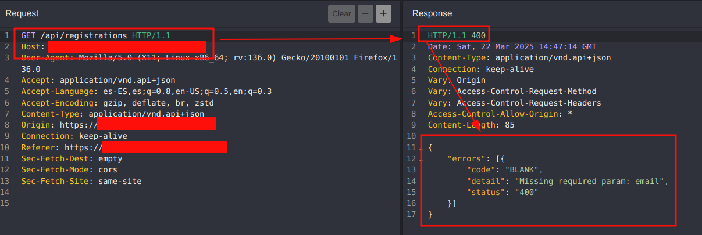

Aunque se espera un `/api/registrations?email=<emailAccount>`, es posible utilizar filtros RSQL para intentar enumerar y/o extraer información de usuarios mediante el uso de operadores especiales:
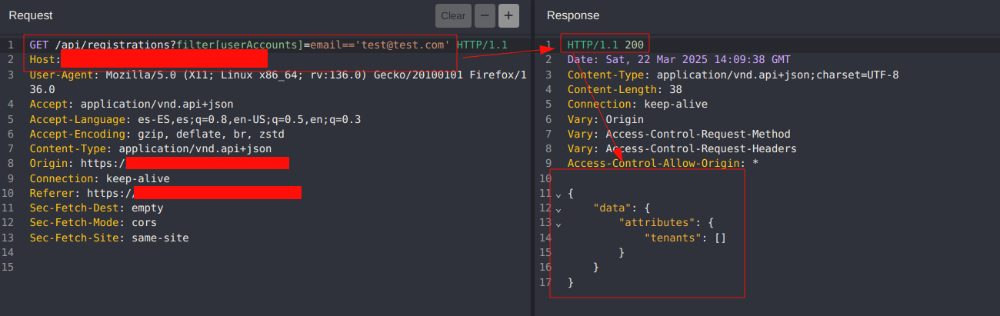

En el caso de coincidir con una cuenta de email válida, la aplicación devolvería la información del usuario en lugar de un clásico *“true”*, *"1"* o lo que sea en la respuesta al servidor:
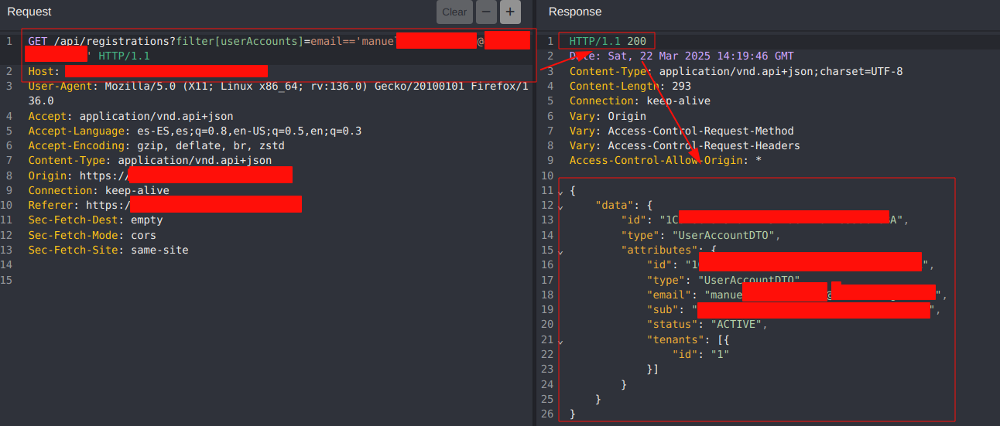

## Evasión de autorización
En este escenario, partimos de un usuario con un rol básico y en el que no tenemos permisos privilegiados (por ejemplo, administrador) para acceder a la lista de todos los usuarios registrados en la base de datos:
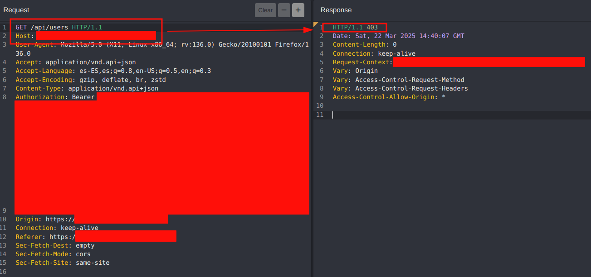

Nuevamente hacemos uso de los filtros y operadores especiales que nos permitirán una forma alternativa de obtener la información de los usuarios y evadir el control de acceso.
Por ejemplo, filtrar por aquellos *usuarios* que contienen la letra “*a*” en su *ID* de usuario:
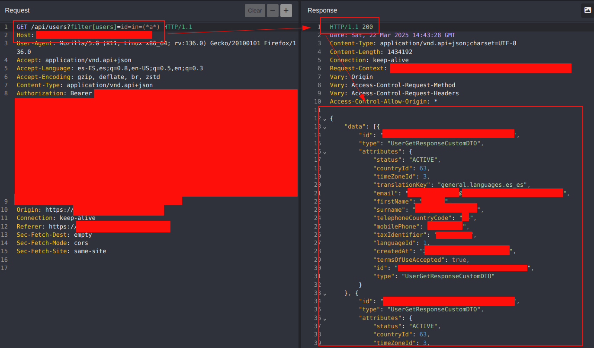

## Escalada de privilegios
Es muy probable encontrar ciertos endpoints que comprueban los privilegios del usuario a través de su rol. Por ejemplo, estamos tratando con un usuario que no tiene privilegios:
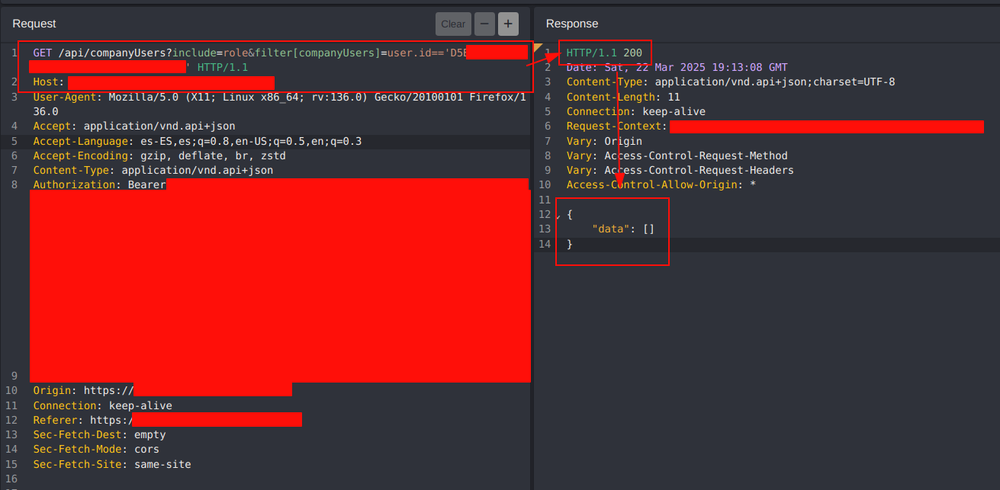

Utilizando ciertos operadores podríamos enumerar usuarios administradores:
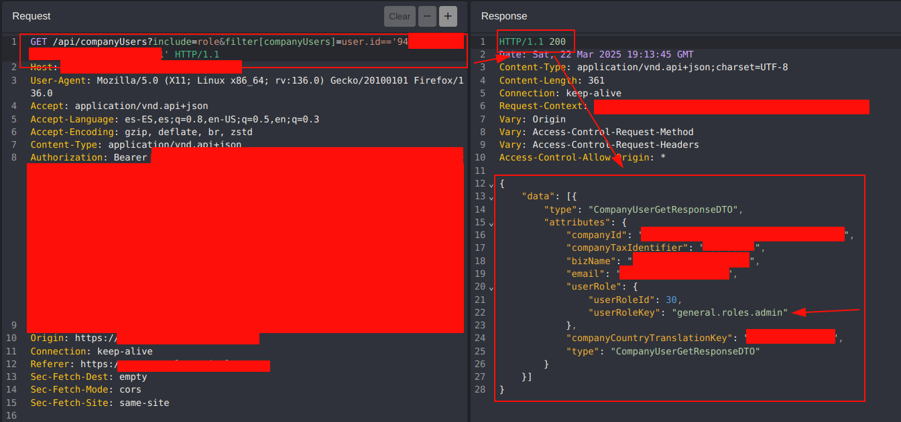

Después de conocer un identificador de un usuario administrador, sería posible explotar una escalada de privilegios reemplazando o añadiendo el filtro correspondiente con el identificador del administrador y obteniendo los mismos privilegios:
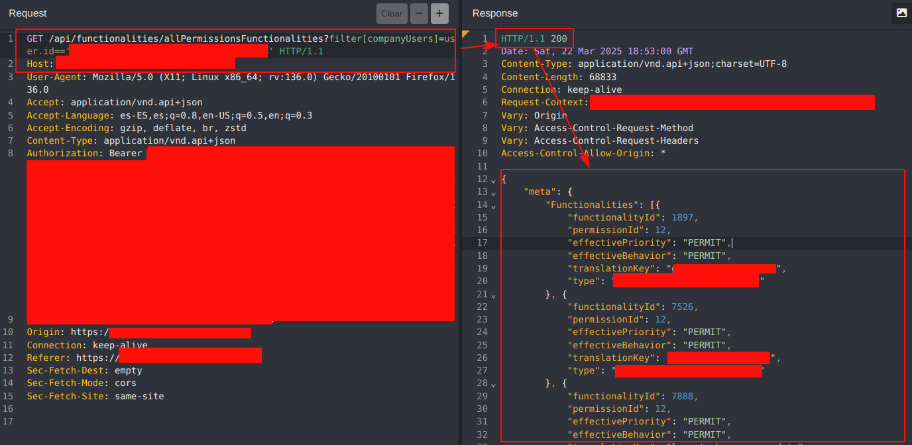

## Suplantación o Referencias Directas Inseguras a Objetos (IDOR)
Además del uso del parámetro `filter`, es posible utilizar otros parámetros como `include`, que permite incluir en el resultado ciertos parámetros (por ejemplo, idioma, país, contraseña...).

En el siguiente ejemplo, se muestra la información de nuestro perfil de usuario:
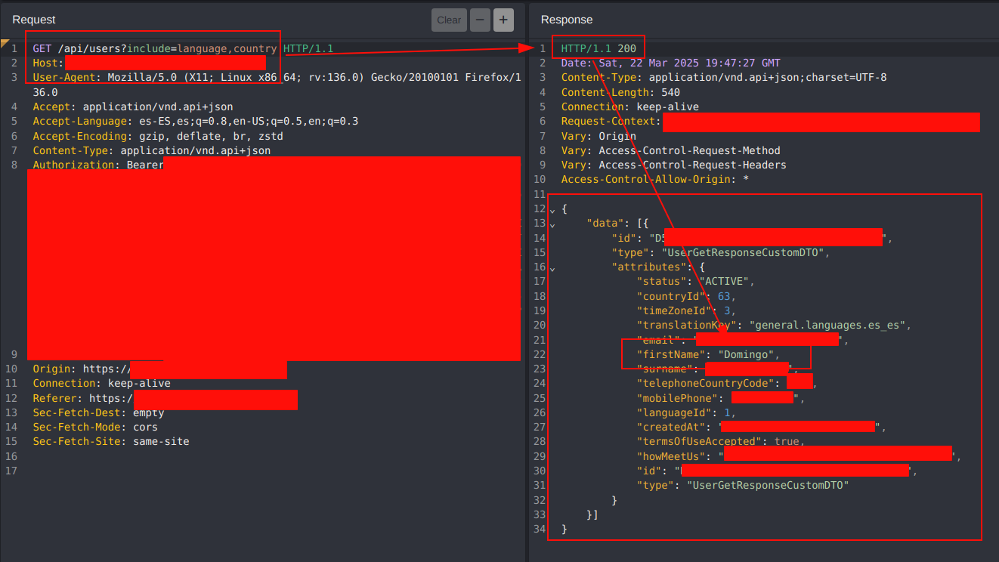

La combinación de filtros se puede utilizar para evadir el control de autorización y obtener acceso a los perfiles de otros usuarios:
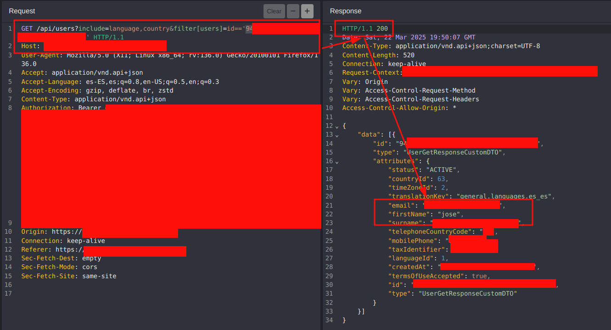

## Mitigación
Las inyecciones RSQL (RESTful Service Query Language) pueden comprometer las bases de datos al permitir consultas maliciosas en los endpoints de la API. Para evitar este tipo de ataque, aquí se presentan una serie de estrategias de mitigación:

- Filtrar y validar todos los parámetros antes de procesarlos.
- Definir listas blancas de operadores y valores permitidos.
- Rechazar caracteres peligrosos como `*`, `=`, `;`, `;`, `,`, `'`, `"` si no son necesarios.
- Prevenir la exposición de identificadores y evitar que el atacante los modifique comprobando que el usuario es legítimo mediante su cookie o token de sesión.

# Agradecimiento
A título personal, quiero expresar mi agradecimiento a **OWASP** por incluir mi investigación sobre el ataque RSQL Injection en su listado de vulnerabilidades: [OWASP - RSQL Injection](https://owasp.org/www-community/attacks/RSQL_Injection). Su labor de documentación y divulgación resulta fundamental para dar visibilidad a este tipo de vulnerabilidades y ayudar a mejorar la seguridad de las aplicaciones web.

## Enlaces
- [OWASP - Inyección RSQL](https://owasp.org/www-community/attacks/RSQL_Injection)